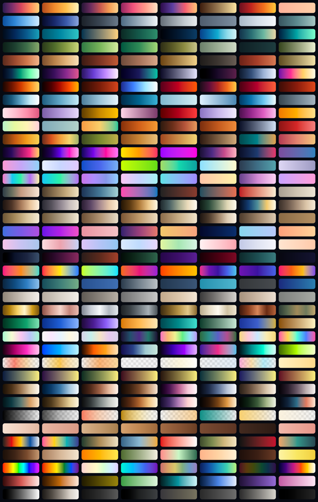
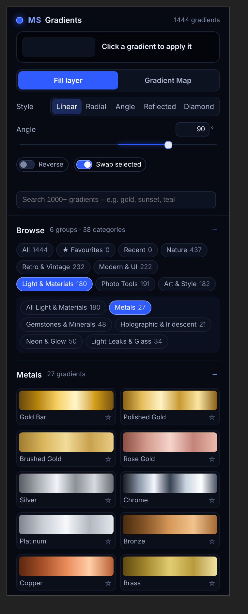

<p align="center">
  
</p>

<p align="center">
  <b>1,444 original gradients for Photoshop in 38 categories – one click puts them into your document as
  normal, fully editable gradient layers.</b><br>
  <sub>Photoshop 2023 (24.2) or newer · UXP panel</sub><br>
  <sub>Free Photoshop tools by <b>Morgenstern</b> · <a href="https://github.com/M0rgenst3rn/ms-distress">Morgenstern Distress</a> · <a href="https://github.com/M0rgenst3rn/ms-printer">Morgenstern Printer</a> · <a href="https://github.com/M0rgenst3rn/ms-render">Morgenstern Render</a> · <a href="https://github.com/M0rgenst3rn/ms-phase">Morgenstern Phase</a> · <a href="https://github.com/M0rgenst3rn/ms-glow">Morgenstern Glow</a> · <b>Morgenstern Gradients</b></sub>
</p>

---

## What is Morgenstern Gradients?

A large gradient library inside Photoshop. Browse by group and category, search by name, mark favourites,
and click a gradient to apply it. The result is a normal Photoshop layer, nothing special: double-click it
and Photoshop's own gradient editor opens. Change stops, angle or style there, or click **New** to save the
gradient to the Gradients panel.

Every gradient was made for this library, from hand-picked palettes. There are no third-party gradient
sets inside, so there is nothing to credit and nothing to worry about when you use them in paid work.

<p align="center"></p>

### Highlights

- **1,444 gradients** in 6 groups and 38 categories, each with a preview
- **Fill layer or Gradient Map**: a gradient fill layer, or an adjustment layer that colours your photo
- **Swap selected**: with a gradient layer selected, a click swaps its gradient. Angle, style, mask and position stay
- **Style, angle and reverse** for new fill layers. Gradient Maps run dark → light automatically
- **Perceptual blending**: colours blend like the eye sees them, without muddy middles
- **Search, favourites and recently used**
- **Gradients panel**: add the shown list or your favourites to *Window › Gradients* as a group, or export a `.grd` file
- **Transparent gradients**: fades, overlays and light leaks keep their transparency
- **Self-test**: checks every function against the real Photoshop result

## The library

| Group | Categories |
|---|---|
| **Nature** | Sunset & Sunrise (61) · Sky & Weather (39) · Ocean & Tropics (45) · Forest & Botanical (37) · Desert & Earth (37) · Aurora & Space (51) · Fire & Lava (44) · Ice & Frost (31) · Flowers & Blossom (46) · Seasons (46) |
| **Retro & Vintage** | 70s Retro (38) · 80s Synthwave (40) · 90s & Y2K (37) · Vaporwave (29) · Vintage Print (43) · Film Looks (21) · Old Paper & Sepia (24) |
| **Modern & UI** | Modern UI (76) · Soft Pastel Blur (24) · Dark & Moody (38) · Bold & Pop (26) · Clean & Corporate (37) · Minimal Neutrals (21) |
| **Light & Materials** | Metals (27) · Gemstones & Minerals (48) · Holographic & Iridescent (21) · Neon & Glow (50) · Light Leaks & Glass (34) |
| **Photo Tools** | Duotone (96) · B&W Toning (22) · Cinematic Grades (21) · Transparent Fades (23) · Skin Tones (29) |
| **Art & Style** | Art Movements (45) · Food & Drink (48) · Rainbow & Spectrum (19) · Monochrome (54) · Black, White & Grays (16) |

The image at the top shows eight gradients of every category, one row per category, in this order.

**Film Looks, B&W Toning, Cinematic Grades, Duotone and Black, White & Grays** are made for Gradient Maps:
they run from shadows to highlights and give a photo a complete colour grade in one click.

## How to use it

1. Open a document and the panel (**Plugins › MS Gradients**)
2. Choose **Fill layer** or **Gradient Map**. For fill layers, also choose style and angle
3. Pick a group and a category, or search (e.g. "gold", "teal film", "sunset")
4. **Click a gradient**: it lands as a new layer above the selected one. With an active selection, the layer gets a matching mask
5. Want a different one? Keep the layer selected and click another gradient: with **Swap selected** on, the layer just changes its gradient
6. **Edit it in Photoshop**: double-click the layer thumbnail. For a fill layer, click the gradient in the dialog to open the gradient editor

**Saving to the Gradients panel:**

- **One gradient:** in Photoshop's gradient editor, type a name and click **New**
- **A whole list:** open *Gradients panel & tools* in the panel and click **Add list to Gradients panel** (adds the list you see, e.g. a category or a search) or **Add favourites**. They appear in *Window › Gradients* as a group "MS Gradients · …"
- **As a file:** **Export .grd…** saves the list. Import it later via *Window › Gradients › menu › Import Gradients…*

## Installation

### macOS (recommended)

1. Download the repository (**Code → Download ZIP**) and unzip it
2. Run this in Terminal inside the unzipped folder:
   ```bash
   bash install-mac.sh
   ```
3. (Re)start Photoshop → **Plugins › MS Gradients**

### Alternative: UXP Developer Tool (macOS & Windows)

1. Install "UXP Developer Tools" from the Creative Cloud app
2. In Photoshop, turn on **Developer Mode** under *Settings › Plugins*
3. In the UXP Developer Tool choose **Add Plugin**, then `gradients/manifest.json` → **Load**

## Project structure

```
gradients/           The plugin (loaded into Photoshop as is)
  manifest.json      Plugin description
  index.html         Panel UI
  ms-ui.js/.css      Shared Morgenstern controls and design
  main.js            Photoshop side (layers, Gradients panel, self-test)
  core.js            Library, search and Photoshop commands, plain JavaScript
  color.js           Colour maths (OKLab)
  grd.js             Writes Photoshop gradient files (.grd)
  library.js         The gradients (generated)
  thumbs/            Previews, one image per category (generated)
install-mac.sh       Packs the plugin (.ccx) and installs it
tools/               Library builder, checks, README images, icons, browser preview of the panel
docs/images/         Images of this README
```

```bash
node tools/build-library.js   # tools/palettes.js -> gradients/library.js + previews
node tools/check.js           # checks without Photoshop (library, commands, .grd)
node tools/make-showcase.js   # rebuilds the image at the top of this README
```

**Adding gradients:** add a line `Name: #colour #colour …` to a category in `tools/palettes.js` (or a new
category), then run `node tools/build-library.js`.

## Found a bug? Got an idea?

Get in touch! The easiest way is **[Issues](https://github.com/M0rgenst3rn/ms-gradients/issues)** here on GitHub:
click **New issue** and briefly describe what happened. Your Photoshop version, operating system and a
screenshot help a lot. All you need is a free GitHub account. Suggestions and feature requests are just as
welcome.

## License

[MIT with the Commons Clause](LICENSE): the plugin is free. You may use it for any work, including paid
client work, and you may read, change and share the code.
You may not sell the plugin or a version of it (changed or not), or charge for a product or service whose
value comes mainly from it.
Everything you create with it (designs, images, prints) is yours, and you may sell it.
The license notice stays in copies.

Adobe and Photoshop are trademarks of Adobe Inc. This project is independent and not affiliated with Adobe.

---

<p align="center"><sub>Morgenstern Gradients<br>
Made by Linus Leinberger</sub></p>
